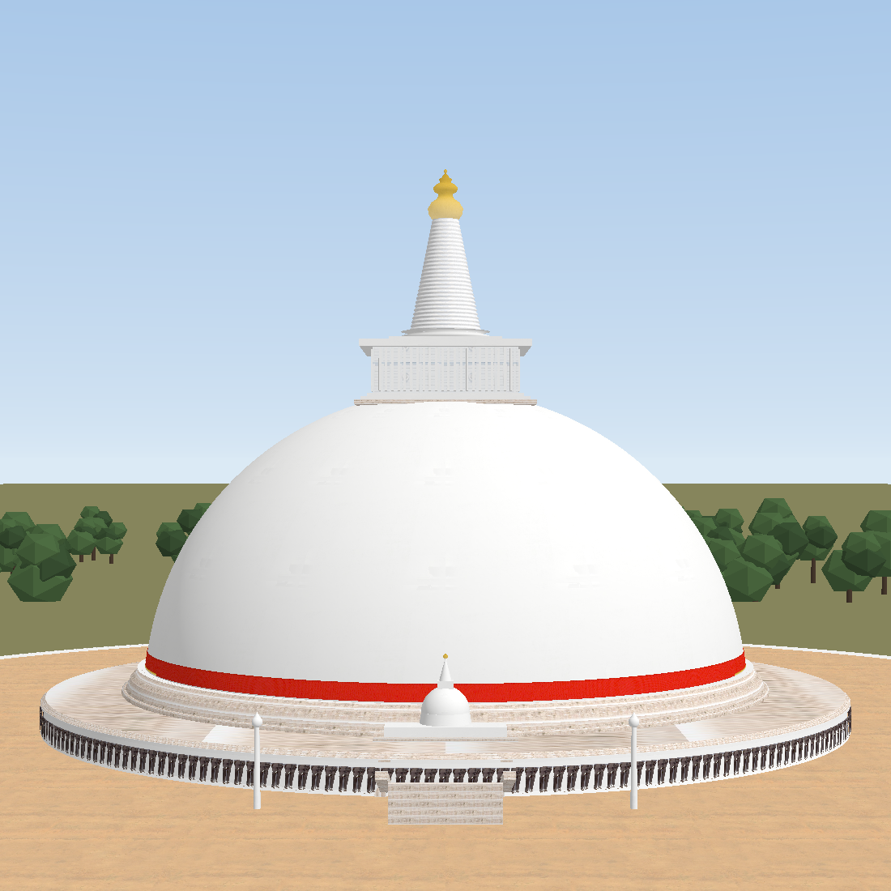
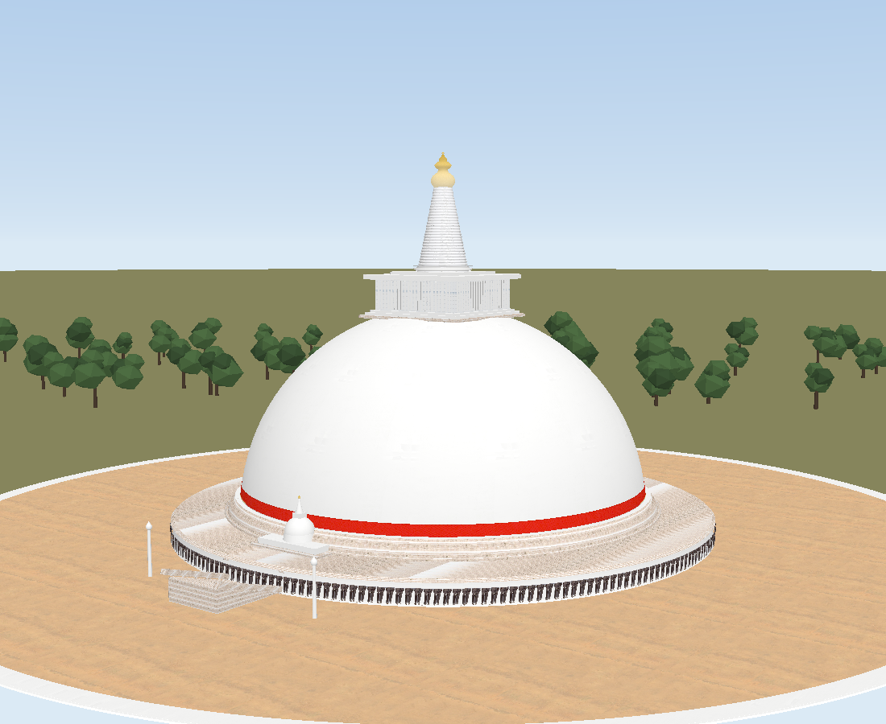
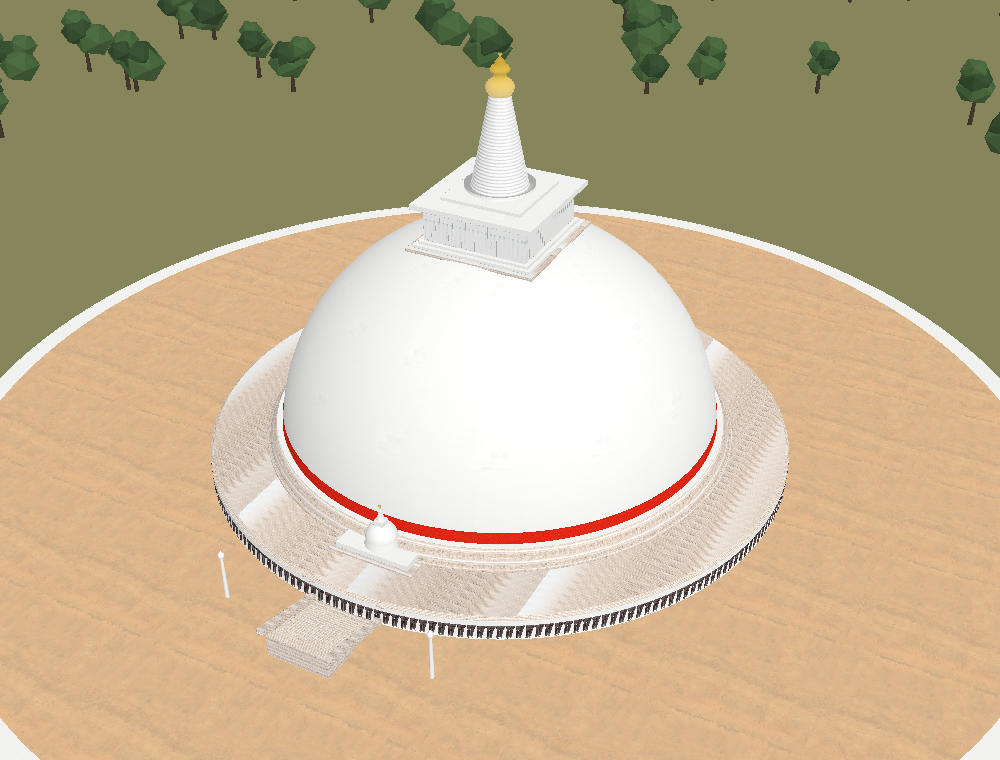
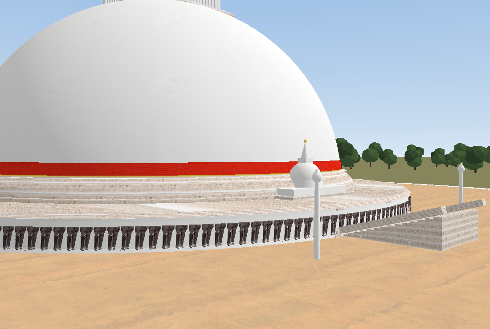
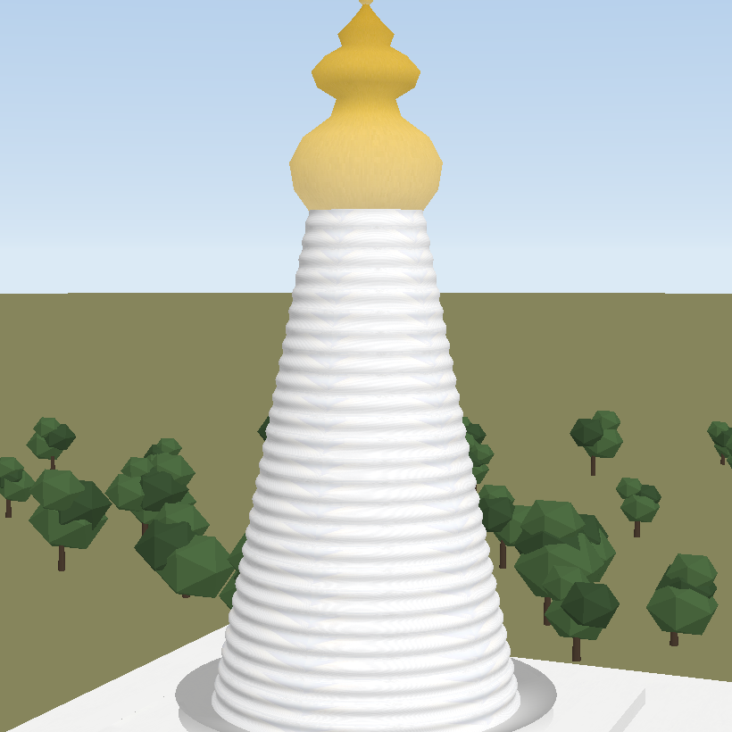
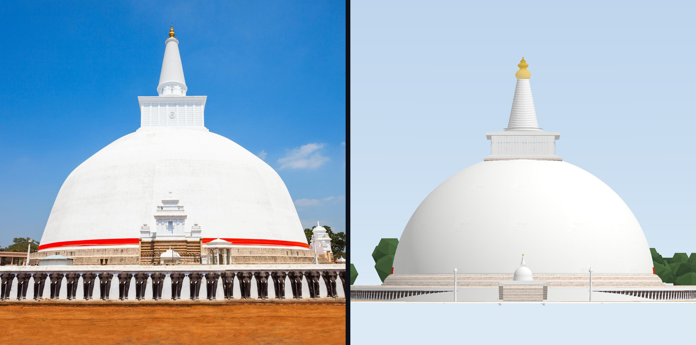

# Ruwanwelisaya — 3D model from one photograph

A textured, interactive 3D reconstruction of the **Ruwanwelisaya Maha Seya** at
Anuradhapura, Sri Lanka — the great white stupa begun by King Dutugemunu
(161–137 BCE) — built from the single photograph supplied with this project.

The photograph does double duty: **every surface in the model is textured with a
crop of it**, and **its proportions are measured from it**, pixel by pixel.



| | |
| --- | --- |
|  |  |
|  |  |

Side by side with the original, rendered from the photograph's own viewpoint and
aligned on two measured points (finial tip and elephant plinth):



---

## Run it

```bash
npm install
npm run dev        # http://localhost:5173
```

`npm run build` emits a static bundle to `dist/`.

The viewer lets you orbit the monument, sweep the sun from golden hour to midday,
toggle between photographic textures and clay, look at the wireframe, hide the
surrounding jungle, jump between camera presets, and **export GLB / OBJ / STL**.

---

## The exported model

`public/models/ruwanwelisaya.glb` — binary glTF 2.0, Y-up, metres, origin at the
centre of the courtyard:

```
14 primitives · 17 materials · 9 embedded textures
145k vertices · 197k triangles · 7.3 MB
```

It validates with **0 errors and 0 warnings** in the Khronos glTF validator:

```bash
npx gltf-validator public/models/ruwanwelisaya.glb
```

The viewer can also export **OBJ** (with UVs) and **STL** at runtime.

---

## Repository map

| Path | What it is |
| --- | --- |
| `assets/source/ruwanwelisaya.jpg` | the uploaded photograph (2 048 × 2 048) |
| `tools/build_textures.py` | derives every texture map from that photograph |
| `src/monument.js` | the geometry: dimensions, profiles, materials — DOM-free, shared by the viewer *and* the exporter |
| `src/main.js` | the browser viewer (three.js, lighting, presets, exporters) |
| `index.html`, `src/style.css` | the interface |
| `tools/export-glb.mjs` | writes the self-contained binary glTF |
| `tools/preview_render.py` | small software rasteriser used to QA the GLB without a browser |
| `tools/make_comparison.py` | renders the model from the photo's viewpoint and aligns the two |
| `public/textures/` | generated texture maps (committed, so it works out of the box) |
| `public/models/ruwanwelisaya.glb` | the finished model |
| `docs/` | renders of the finished model |

---

## How the photograph became a model

### 1. Measuring the monument

The dome silhouette is very nearly a circle. Thresholding the sky and walking
each scanline in from the centre, then fitting a circle to the springing line,
gives a circle of **radius 766 px centred at (1024, 1486)** — that is, the
sphere's centre sits *below* the springing line, which is exactly what makes the
profile read as a bubble rather than a hemisphere.

Taking the dome radius as 42.6 m fixes the scale at **0.0556 m per pixel**, and
every local dimension is then measured directly:

| Measured in the photo | Model |
| --- | --- |
| dome radius 766 px | **42.6 m** (85 m across) |
| apex above springing 705 px | **39.6 m** |
| sphere centre 61 px below springing | **4.0 m below** |
| harmika width 370 px | **20.3 m square**, 7.2 m tall |
| kasaya band thickness 35 px | **2.35 m** |
| elephant relief pitch ~92 px | **224 reliefs**, each 1.55 × 2.95 m |
| finial tip above apex 551 px | **79.1 m** overall |

The camera in the photograph is a long lens from a low viewpoint; the model is
built orthogonally and the comparison render reproduces that viewpoint with an
explicit pinhole camera (760 m back, 9.4° vertical FOV).

### 2. Making the textures

`tools/build_textures.py` crops a clean patch of each material out of the
photograph and turns it into a tileable map:

* **whitewash** — the photographed dome carries a slow lighting gradient, and a
  gradient cannot tile. The crop is **frequency separated**: only the
  high-frequency plaster grain survives, that grain is made seamless with a
  mirrored cross-fade, and it is laid over a flat base colour.
* **elephants** — one 90 × 167 px basalt relief, matted with a **flood fill from
  the image border**, so the white plaster wall behind disappears while the
  white tusks stay opaque. The matte doubles as a height map for bump.
* **red kasaya cloth** — sampled from inside the band. The cloth is a flat
  vermilion, so its measured colour and grain are combined with a woven
  micro-pattern and the shading where the fabric tucks around the dome.
* **weathered masonry** — one photographed brick course, made seamless, then
  stacked in four courses with alternating offsets and recessive shading.
* **harmika face, spire** — de-skied and frequency separated; the spire's ribbing
  is modelled in geometry, so its map only carries the whitewash grain.
* **gold finial** — only ~40 px wide in the photo, so rather than upscaling a
  blur the finial is *measured* (mean gold 181,131,44; shadow 140,87,2;
  highlight 251,216,145) and rebuilt as a clean gilded ramp in exactly that hue.
* **sand** — frequency separated, so the graded courtyard tiles while keeping its
  rake marks.

Nine maps come out of this, all embedded in the GLB.

### 3. Building the geometry

`src/monument.js` assembles the monument from lathes, rings and boxes:

* **spherical-cap dome** (240 segments) with the **red kasaya band** and its
  gilded fringe slung just above the springing line;
* battered **masonry drum** with four weathered courses;
* **ambulatory terrace** and the outer wall carrying **224 individually textured
  basalt elephant reliefs**, merged into a single draw call;
* **harmika (deva-kuti)**: stepped plinth, fluted block with corner pilasters and
  frieze bands, cornice, lotus cushion;
* **ribbed conical spire** — 30 mouldings — and the **gilded finial**;
* **frontage**: a 14-step flight through the elephant wall with sloped
  balustrades and moonstones, the altar with its own small dagoba, and lamp posts;
* a ring of jungle canopy framing the courtyard (with the approach avenue left
  clear).

The same module drives the viewer and the exporter, so the GLB is exactly the
monument you orbit — including its baked UV tiling.

### 4. Checking it

`tools/preview_render.py` is a small z-buffered, texture-mapping rasteriser with
one sun and a sky gradient; it renders the exported GLB so the result can be
inspected without a browser. `tools/make_comparison.py` uses it to reproduce the
photograph's viewpoint and lays the two images side by side, aligned on the
finial tip and the foot of the elephant wall — the check that caught the initial
over-tall dome and the too-small elephant frieze.

---

## Regenerating everything

```bash
python3 -m venv .venv && .venv/bin/pip install pillow numpy
.venv/bin/python tools/build_textures.py                        # → public/textures/
node tools/export-glb.mjs                                       # → public/models/*.glb
.venv/bin/python tools/preview_render.py --out docs/render-front.png \
        --cam 0,38,245 --look 0,40,0 --fov 30                    # QA render
.venv/bin/python tools/make_comparison.py                       # → docs/comparison.jpg
```

---

## Notes and limitations

* This is a single-view reconstruction: surfaces the photograph cannot see (the
  rear of the harmika, the inner face of the terrace wall, the underside of the
  dome lip) are extrapolations from the visible parts. The elephant ring is
  therefore even, rather than the staggered spacing perspective implies.
* The photograph's own lighting is baked into the crops; the viewer's sun is
  layered on top, so the model is most faithful near the photo's light direction.
* People, fencing, tents and the blue-roofed shed in the original frame are
  deliberately excluded.
* Metric scale is nominal: the model preserves the photograph's proportions, and
  the metres quoted follow from assuming the dome is 85 m across.
